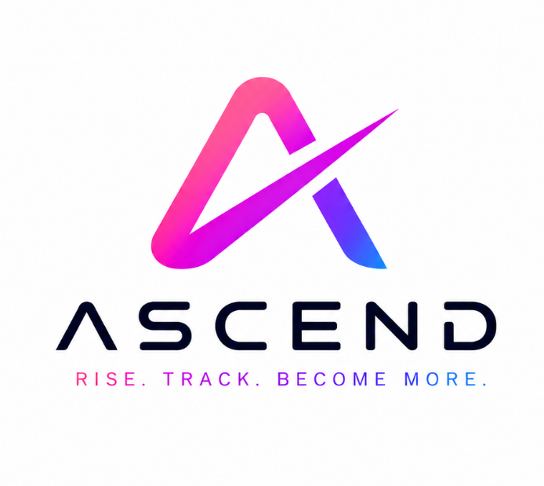

# Ascend



### RISE. TRACK. BECOME MORE.

**My app helps new Ascend users create a personalized fitness profile by validating their information, checking whether their goal weight aligns with their fitness goal, and estimating their daily calorie needs based on their personal metrics and activity level.**

Ascend started in MIST 2090 as a fitness and wellness app — workout discovery, daily progress tracking, and motivation in one place. In MIST 4600, this project builds the working part: new-user profile setup only. Workout logging, meal tracking, and wearables are out of scope here.

> A course project for **MIST 4600: Computer Programming in Business** at the University of Georgia's Terry College of Business.

## Problem

New Ascend users need to create a personalized fitness profile, but it is hard to know whether their information is complete and realistic, whether their goal weight matches their fitness goal, and how many daily calories they need. Ascend helps a new user make that profile decision with validated inputs and a clear calorie estimate instead of guessing.

## What it does

My app answers four data questions (Q4 optional), exactly as submitted in my proposal:

| # | Sub-question | How the app answers it |
|---|---|---|
| 1 | How does the distribution of fitness goals compare among Ascend users? | Count + % per goal, with pandas |
| 2 | How does activity level affect the average recommended daily calorie intake? | Group by activity level, compare average estimated daily calories, with pandas |
| 3 | Among lose/gain users, what is the typical desired % weight change for each activity level? | Median desired % change, lose and gain kept separate, grouped by activity level, with pandas |
| 4 | (Optional) How do fitness goals and average daily calorie needs differ across age groups? | Group by age group (draft ranges 18-24, 25-34, 35-49 — not committed in the proposal) |

For each new user, the app also validates the 8 profile fields (name, age, height_inches, weight_lbs, fitness_goal, goal_weight_lbs, activity_level, sex), checks the goal weight (lose = goal < current, maintain = goal = current, gain = goal > current), and estimates goal-adjusted daily calories: Mifflin-St Jeor BMR x activity = maintenance (low 1.2, moderate 1.55, high 1.725), then lose -500, maintain 0, gain +500. That ±500 is a simple documented rule, about 1 lb/week — my choice, not a medical recommendation. Validation and the goal-weight check are part of what the app does for a new user; they are not data questions.

The Streamlit web app (`app.py`) is an interactive profile form collecting the same 8 fields, with the Ascend branding from MIST 2090: dark navy, gradient pink → magenta → purple → blue, and the tagline above.

## Data

`sample_profiles.csv` is fabricated sample data, made up for this project because Ascend has no real users yet. It has 100 realistic profiles: ages 18-45, heights 60-76 in, weights from BMI 18-31, goal changes lose -4% to -12%, gain +4% to +9%, maintain 0%. No real users, no real names or personal metrics. Do not add real profiles to this public repo.

## Built with

- Python and pandas, in Google Colab (`ascend.ipynb`)
- Google Gemini API, called from the notebook for one personalized recommendation per new user
- Streamlit, for the interactive profile form (`app.py`)

## How to run it

1. Open `ascend.ipynb` in Google Colab.
2. Put `ascend.ipynb` and `sample_profiles.csv` in the same folder in your Google Drive.
3. Add your Gemini key to Colab Secrets (key icon on the left) with the name `GOOGLE_API_KEY`, and turn on **Notebook access**. Get the key at [aistudio.google.com](https://aistudio.google.com) with a personal Gmail account. Never type the key into the code.
4. Runtime → **Run all**. The Gemini cell calls Gemini once, so it takes a few seconds.

To run the Streamlit app locally:

```bash
pip install -r requirements.txt
streamlit run app.py
```

Live Streamlit app link: coming soon — the app will be deployed on Streamlit Community Cloud, and the link will be added here.

## Example output

One profile — 20-year-old male, 72 in, 185 lb, lose to 176 lb, moderate activity:

```
Errors: []
Goal check: Goal weight 176 lb fits 'lose weight' at 185 lb.
Maintenance calories: 2925
Estimated daily calories (goal-adjusted, lose -500): 2425
Desired change %: -4.86
```

100 sample profiles:

- Q1: lose 43 (43.0%), gain 36 (36.0%), maintain 21 (21.0%)
- Q2: average goal-adjusted daily calories — low 1,819.9 (n=24), moderate 2,331.3 (n=51), high 2,915.6 (n=25)
- Q3: median desired % change — lose -7.72% (low, n=10), -8.50% (moderate, n=25), -8.10% (high, n=8); gain +7.37% (low, n=7), +5.90% (moderate, n=18), +6.67% (high, n=11)

These numbers describe the app's goal-adjusted estimates for the sample profiles. Because the estimate includes the goal (-500 / 0 / +500), activity groups may also differ in their mix of goals, so a higher average in one group is a difference in goal-adjusted estimates, not proof that activity alone caused it.

## AI Use Disclosure

Coming soon — to be completed by Eduardo.

## Author

Eduardo Torres
